# Caffeine

A small GNOME app that keeps your computer awake. While the Caffeine window is open, the system won't suspend; close the window and normal power settings apply again.



## Building

Caffeine is written in GJS with GTK 4 and libadwaita, and builds with Meson.

### Flatpak

```sh
flatpak-builder --user --install --force-clean build codes.tamado.Caffeine.json
flatpak run codes.tamado.Caffeine
```

The manifest builds from the `main` branch of this repository on GitHub, so local changes that aren't pushed won't be included.

### From source

Requirements: `meson`, `gjs`, GTK 4, libadwaita, and `glib-compile-resources`.

```sh
meson setup _build
meson compile -C _build
meson install -C _build
```

`meson test -C _build` validates the desktop, AppStream, and GSettings files.

## License

GPL-3.0-or-later. See [COPYING](COPYING).
